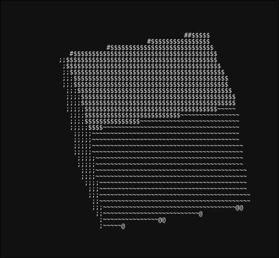

# ascii-cube-rs

A Rust + WebAssembly project that renders a rotating ASCII cube for the browser.

**Live demo:** https://strange500.github.io/ascii-cube-rs/



## Overview

`ascii-cube-rs` exports a `Cube` engine from Rust to JavaScript with `wasm-bindgen`.  
The engine generates animated ASCII frames with per-face color and optional face logos, making it useful for terminal-style web visuals, hero sections, and creative UI effects.

## Features

- Rotating 3D ASCII cube rendered as HTML-safe text
- Per-face color configuration
- Optional per-face ASCII logo overlay
- WebAssembly-powered rendering logic written in Rust
- Browser integration through ES module imports

## Project Structure

- `src/lib.rs` – Rust cube engine and WASM exports
- `index.html` – browser demo page
- `example.png` – sample output image

## Requirements

- Rust (stable)
- `wasm-pack`

Install `wasm-pack`:

```bash
cargo install wasm-pack
```

## Build and Run Locally

From the repository root:

```bash
wasm-pack build --target web --out-dir pkg
```

Then serve the repository with any static HTTP server (for example):

```bash
python3 -m http.server 8000
```

Open `http://localhost:8000` in your browser.

## API (WASM Exports)

The generated module exports `Cube`:

- `Cube.new(width, height)` – create a cube renderer
- `set_zoom(zoom)` – set projection scale
- `set_face_color(face_index, hex_color)` – set face color (`0..5`, hex like `"#ff0000"`)
- `set_face_logo(face_index, logo)` – set multiline ASCII logo on a face
- `next_frame()` – compute and return the next HTML-ready frame string
- `is_face_visible(face_index)` – check if a face is currently visible

Face indices:

- `0` Top
- `1` Bottom
- `2` Left
- `3` Right
- `4` Front
- `5` Back

## Import in a Web Project

After building with `wasm-pack`, import from `pkg/cube.js`:

```html
<script type="module">
  import init, { Cube } from "./pkg/cube.js";

  async function run() {
    await init();

    const cube = Cube.new(180, 90);
    cube.set_face_color(4, "#00ff88");
    cube.set_face_logo(4, "ASCII\\nCUBE");

    const target = document.getElementById("terminal");

    function render() {
      target.innerHTML = cube.next_frame();
      requestAnimationFrame(render);
    }

    render();
  }

  run();
</script>
```

Use a `<pre>` element with `white-space: pre` and a monospace font for best results.

## License

This project is currently distributed without an explicit license file.
Add a `LICENSE` file if you want to define usage and redistribution terms.

## Sampling and regression checks

`Cube::new` retains 100×100 samples per face for buffers up to 120 columns.
Larger buffers use their column count (capped at 256) as the sampling width.
The points, z-buffer projection and shared-memory API remain in Rust. Texture
uploads through `update_face_fast` always remain 100×100, row-major; the engine
resamples them onto its internal surface grid. Do not enlarge the texture upload
just because the output buffer is larger.

After `wasm-pack build --target web --mode no-install --release`, run:

```sh
node scripts/test-raster.mjs
```

This checks the legacy raster and texture contract, 720 orientations at
200×100 / zoom 3300, and all four texture/color quadrants at that resolution.
The Nix shell uses the minimal pinned stable Rust toolchain with the WASM target,
so downloading the Rust HTML documentation is not required.
